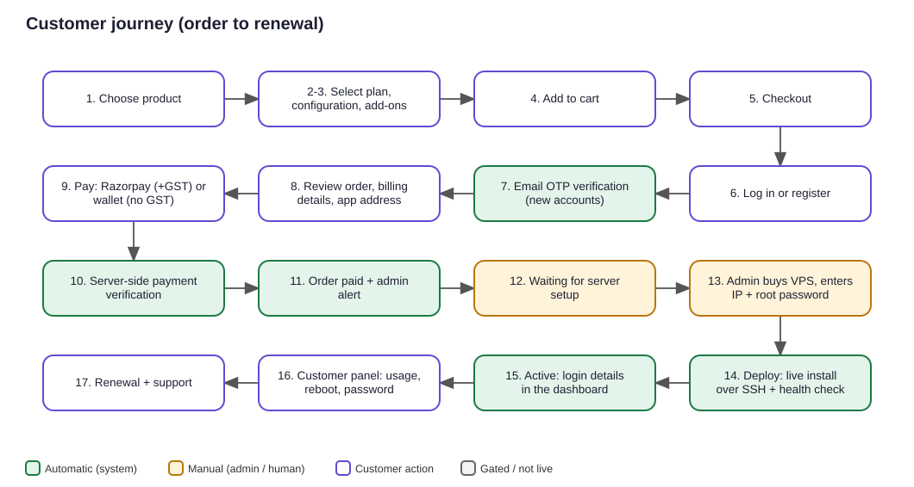
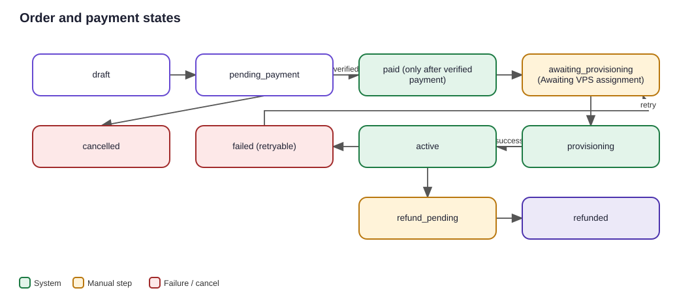
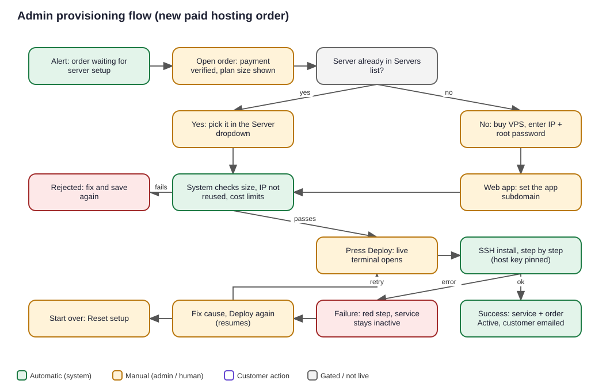
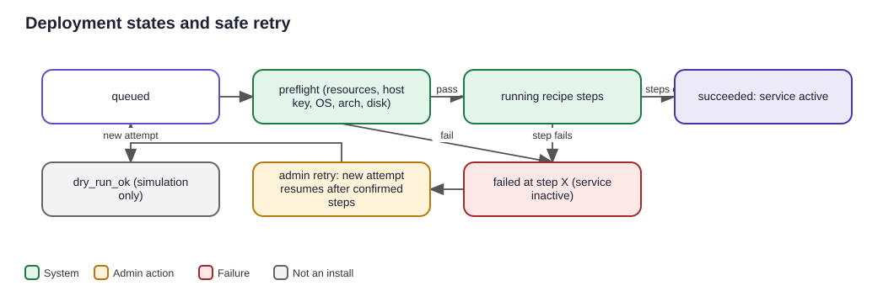

# Complete workflow - DeveloperJet

Last updated: 2026-11-28. Facts below were read from the code. "Verified live" means it ran on the owner's test VPS or the live site; everything else is covered by automated tests on SQLite only.

Status words: **Live** = built, switched on and used. **Built** = code and tests exist. **Gated** = built but switched off until the owner approves. **Planned** = not built.

## 1. Overview

DeveloperJet (AmbitionHost Pvt. Ltd.) sells self-hosted AI and developer hosting: every hosting product is a VPS dedicated to one customer. DeveloperJet installs the software over SSH, then hands the server over with full root access. After hand-over the customer owns the server and its data; backups are not included (a backup plan is sold separately through sales). Digital services (websites, SEO, Business Automation) are quote-based.

## 2. Products

| Product | Plans | Delivery |
|---|---|---|
| Hermes CLI | Spark, Pulse, Drive, Surge, Turbo (approved prices) | Live install over SSH |
| Hermes Workspace | Desk … Enterprise (approved prices) | Install step not approved yet: staff install it and press "mark delivered" |
| n8n Hosting | Trigger … Nexus (approved prices) | Live install (Docker + n8n + Caddy HTTPS on the app address) |
| OpenClaw Hosting | Scout … Commander (approved prices) | Install step not approved yet (manual hand-over) |
| AI Complete Bundle | Complete, ₹5,999/month (owner-approved) | Not approved yet (manual hand-over) |
| Docker VPS Hosting | Nano … Mega (owner prices from ambitionhost.in) | Live install (Docker Engine + Compose) |
| Node.js Hosting | Node Starter, Node Pro, Node Business | Live install (Node.js 22, PM2, Git, Caddy). Installer verified in a clean container, not yet through a full Deploy |
| Claude Code Hosting | Draft slots, price pending | Installer approved; plans cannot be bought until priced |
| AI All-Access | AI Starter, AI Pro, AI Team, AI Business (API credit) | No server: staff create an API key at the AI gateway and paste it on the order |
| Digital services, Business Automation | Quote on request | Lead → quotation → project. Nothing is charged automatically |

Yearly price = 12 × monthly (owner decision: no yearly discount). Quarterly and half-yearly prices stay blank until set in Admin → Products & plans. Prices come only from the database; nothing is hard-coded in Blade.

## 3. Customer journey

1. **Register** with name, email, phone (E.164, +91 default, no SMS) and password. A 6-digit email code verifies the account; checkout and dashboard stay locked until then. The cart survives sign-in.
2. **Choose a plan** on a product page. Pages with more than 3 plans use an arrow carousel; `/n8n#plan-n8n-edge` style links scroll to one plan.
3. **Checkout.** Web apps (Hermes Workspace, n8n, OpenClaw, Bundle) can choose "Use a DeveloperJet address" (default) or "Use my own domain" (verified later by a DNS TXT record). No AI key is asked at checkout. The "Billed to" card comes from Profile → Billing details (company, GSTIN, address).
4. **Pay.** Razorpay adds GST (default 18%, Admin → Settings → Tax); paying fully from the wallet has no GST. The Razorpay window opens straight after placing the order. The browser result is never trusted: only a verified signature (or webhook) plus amount match marks the order paid.
5. **Wait for setup.** The dashboard shows a 6-stage timeline (Order Confirmed → Environment Preparing → Application Installing → Security Configuration → Final Verification → Ready to Use) built only from recorded state. Delivery is not instant: staff buy and set up a VPS first.
6. **Use the service** from the customer panel (section 8).

## 4. Payments and orders

- Razorpay: server-created order, checkout signature and webhook signature verified, idempotent event log, `payments:reconcile` every 15 minutes settles captured payments the browser missed. Refunds are recorded manually (no gateway refund API). PTSure was removed.
- Wallet: append-only ledger, never negative, top-up requests verified by staff, idempotent references.
- Order states: draft → pending_payment → paid → awaiting_provisioning (shown as "Waiting for setup") → provisioning → active. Side paths: failed (retryable), cancelled, refund_pending, refunded. Invalid jumps are rejected; every change is in the order timeline.
- Invoices only for paid orders, atomic numbering with configurable prefix, PDF, credit notes for refunds.

## 5. Server setup and install (admin order page)

The order page has one step card per service: **Server & address → Install → Delivered**.

1. **Server & address.** Pick a server already added under Servers, or "New VPS" and type its IP, SSH user (default root), root password or SSH key and port (default 22). Web apps also need the app address (subdomain) unless the customer gave a verified domain. Plans without a catalogue size ask for vCPU/RAM/disk. The system refuses an IP already used by another customer and checks size, access model and cost/margin limits. The password is stored encrypted and never shown in logs.
2. **Install.** Press **Deploy**: the live terminal opens and streams each step. SSH uses trust on first use: the first connection pins the server's SHA256 host key, a later mismatch stops before the password is sent. Each step is a reviewed, idempotent script in `resources/provisioning/*.sh`; a step whose command is `null` (not approved) stops the run safely. Only one deployment runs per service; a retry resumes after completed steps.
3. **Delivered.** On success the service and order become Active and the customer is emailed. Buttons: Reboot, Restart app, Reset app login (n8n), Suspend / Unsuspend, Reinstall fresh (deletes the app and its data, then installs again).

- **Mark delivered** ("I installed it myself") appears only when automatic install cannot deliver that product (live install off, or the recipe has an unapproved step). With live install on, n8n, Hermes CLI, Claude Code, Docker VPS and Node.js show only Deploy.
- **Start over → Reset setup** (before delivery only): puts the server back into inventory and clears the app address and size. It does not wipe the VPS.
- `php artisan orders:purge <number>` permanently deletes a TEST order (typed confirmation; refuses an order with a verified live payment).

Approved install scripts (verified on the test VPS, Ubuntu 24.04): common security, dependencies, Docker, web ports, record state; n8n install + health; Hermes CLI (official installer, about 15 minutes); Claude Code (official installer); Docker health; Node.js install + health (verified in a clean container). Not approved: Hermes Workspace, OpenClaw, the shared Hermes runtime for the Bundle, and the generic domain/HTTPS/backup steps.

## 6. Production switches

Live install needs, in `.env` on the server: `PROVISIONING_LIVE_ENABLED=true`, `PROVISIONING_WORKER=ssh`, phpseclib from `composer install`, and outbound port 22. Live deploys run after the HTTP response by default (`PROVISIONING_DISPATCH=after_response`), so no queue worker is needed for them. The owner confirmed these are on in production (2026-11-25).

## 7. AI All-Access delivery

Paying creates an `ai_access` service with no server. On the order page staff create a key at the AI gateway (ModelGo), paste the key, base URL(s) and credit, then press Deliver. The key is stored encrypted. The customer page shows the base URL, the key behind Show/Copy and snippets for Claude Code, the OpenAI SDK, n8n and Hermes. Suspend / Unsuspend remind staff to disable the key at the gateway. Open risk: ModelGo's terms restrict giving credentials to other people; the owner must confirm reseller use with ModelGo.

## 8. Customer service panel

`/dashboard/services/{id}` for a delivered server:

- **Overview:** live server usage (CPU, RAM, disk, network rate, uptime, load, swap, hostname) read over SSH by the read-only `common/stats.sh`, cached 55 seconds and refreshed every 60 seconds; server details; "Getting started" or the product's AI-key command (`config/provisioning.php` key_help); health checks when recorded; "Backups are not included".
- **Login & SSH:** IP, username, root password (Show/Copy), port, how to connect (ssh and PuTTY), and **Root password**: type your own (12–64 printable characters, letters and digits, typed twice) or "Generate a strong password for me". The new password is set with `chpasswd` (sent base64-encoded) and saved encrypted. Only for password logins as root.
- **Manage:** Reboot, Restart app, Reset login (where the product supports it), Upgrade plan (via support), Domain (web apps: own domain + TXT verification), and **Reinstall fresh** (type REINSTALL).
- **Billing:** plan, cycle, renewal date, last invoices.

If the panel cannot reach the server (for example the root password was changed with `passwd`), it says so instead of showing numbers. Panel routes use the named limiters `vps-stats` (30/min) and `vps-sensitive` (8 per 10 minutes per route), so usage polling never uses up the password/reinstall allowance. Power off/on and a browser console need our own hypervisor (Proxmox, planned).

## 9. Billing and renewals

- `billing:run` (daily 08:00) creates one renewal invoice + renewal order per period from the subscription's agreed price snapshot (no setup fee), sends reminders, and moves subscriptions through grace → overdue → suspension queue.
- Defaults (admin-editable): renewal invoice 7 days before due; reminders 7 and 3 days before, on the due date and 1 day overdue; 3 grace days; auto-suspend OFF; cancellation approval ON; immediate cancellation OFF; automatic expiry OFF; add-ons billed from the next renewal; no proration engine.
- Paying a renewal extends the existing subscription from the paid-through date (month-end and leap-year safe). Duplicate callbacks never extend twice.
- Suspension through a supplier API only with a verified adapter and `billing.live_suspension_enabled` (off). Otherwise a staff task + Telegram alert are created. Staff can suspend the app over SSH from the order page.
- Cancellation requests: end of period or (if allowed) immediate; staff approve or reject with a note. Ended services open a `retention_review` task; nothing is deleted automatically.
- Renewal orders from `billing:run` use the standard GST rate.
- Supplier renewals: `servers:check-renewals` (daily 08:30) alerts once per server renewal date.

## 10. Notifications

Events: new order, payment success/failure, server setup needed, deployment started/failed/completed, monitoring alert, server renewal due, renewal reminders, invoice generated/due, ticket created, new lead. Channels: Telegram (admin), email (customer, editable templates) and the admin notification log. Alerts are queued with retries and de-duplicated (`notification_logs.dedupe_key`). Failed Telegram alerts can be retried. Real SMTP delivery depends on production `.env` (see `docs/05_CPANEL_DEPLOYMENT.md`).

## 11. Support

Tickets with department, priority, safe attachments and numbers. Staff reply publicly or add private notes that customers never see. Staff see only departments they belong to. Filters: status, priority, department, mine, unassigned, escalated, SLA missed, search. Optional SLA hours per priority with a department override (blank = no SLA); `support:sla-check` every 15 minutes, optional auto-escalation (3 levels).

## 12. Business Automation and digital services

`/business-automation`: three quote-only plans (Starter, Growth, Enterprise, price pending) and a requirement form protected by CSRF, rate limiting, honeypot, signed timing token, sanitisation, secret redaction and duplicate suppression. Each request gets a reference; acknowledgement, sales email and Telegram alert are queued.

Lead lifecycle (10 statuses): New Request → Reviewing → Assigned to Sales → Requirements Discussion → Quotation Prepared → Quotation Sent → Customer Accepted / Customer Declined → Converted to Project → Closed. Illegal moves are rejected. The customer accepts or declines on the dashboard; acceptance never charges. Conversion opens a project (milestones, deliverables, messages, tasks) and is idempotent. Internal notes and contact records never reach the customer. Who can see which lead: `docs/04_STAFF_ACCESS.md`.

## 13. Staff portal

All staff sign in at `/staff/{slug}/login` (default `developerjet`) on the separate `staff` guard; `/admin` is 404 for outsiders. The admin sidebar has 9 sections (Dashboard, Orders, Customers, Servers, Billing, Support, Products, Sales, Settings); each section's pages are tabs at the top, filtered by permission. Login, MFA, roles and recovery commands: `docs/04_STAFF_ACCESS.md`. Owner-facing walkthrough with screenshots: `docs/06_ADMIN_GUIDE.md`.

## 14. Failure recovery

- **Payment captured, order unpaid:** reconciliation settles it; duplicate webhooks are ignored. Do not ask the customer to pay twice.
- **Deploy failed:** the terminal shows the red step; service stays inactive. Fix the cause and press Deploy again (resumes), or Reset setup to use another server.
- **Host key mismatch:** the run stops before sending the password. Confirm with the supplier whether the VPS was rebuilt before clearing the pinned key (changing the IP on the order clears it).
- **Unsupported OS / no SSH:** reinstall Ubuntu 22.04/24.04 or Debian 12 from the supplier panel, then Deploy again.
- **Panel says "could not reach your server":** the server is rebooting, or its root password was changed outside the panel. Ask the customer for the new password and save it on the server record (Servers → edit → root password).
- **Wrong server picked:** Reset setup before delivery; the VPS itself is not wiped.

## 15. What is not built or not verified

- Proxmox / own hypervisor (automatic VPS creation, power off/on, browser console, OS reinstall from the panel): planned, needs a dedicated server.
- Supplier APIs (DesiVPS, EricHost, Contabo, Server Broker): none assumed; adapters only from official docs and authorised credentials.
- Install scripts for Hermes Workspace, OpenClaw and the Bundle.
- Not run live yet: customer root password change, customer reinstall, reboot, n8n reset login on a real customer server; Node.js install through a full Deploy.
- Razorpay with real money, real Telegram delivery, backups, XLSX exports, per-plan renewal overrides, real-device and screen-reader testing.
- Owner decisions still open: Claude Code prices, quarterly/half-yearly prices, ModelGo reseller permission, n8n Sustainable Use License risk (owner accepted it).
