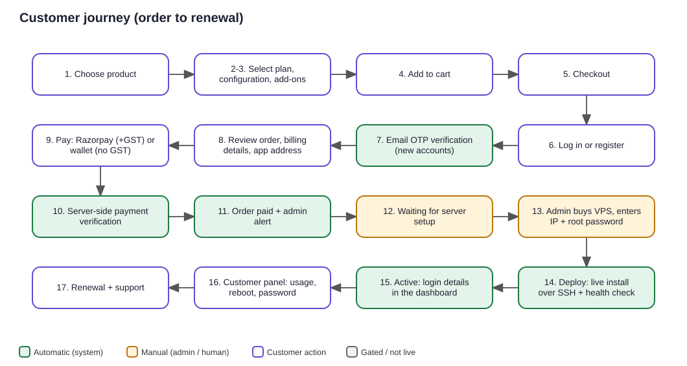
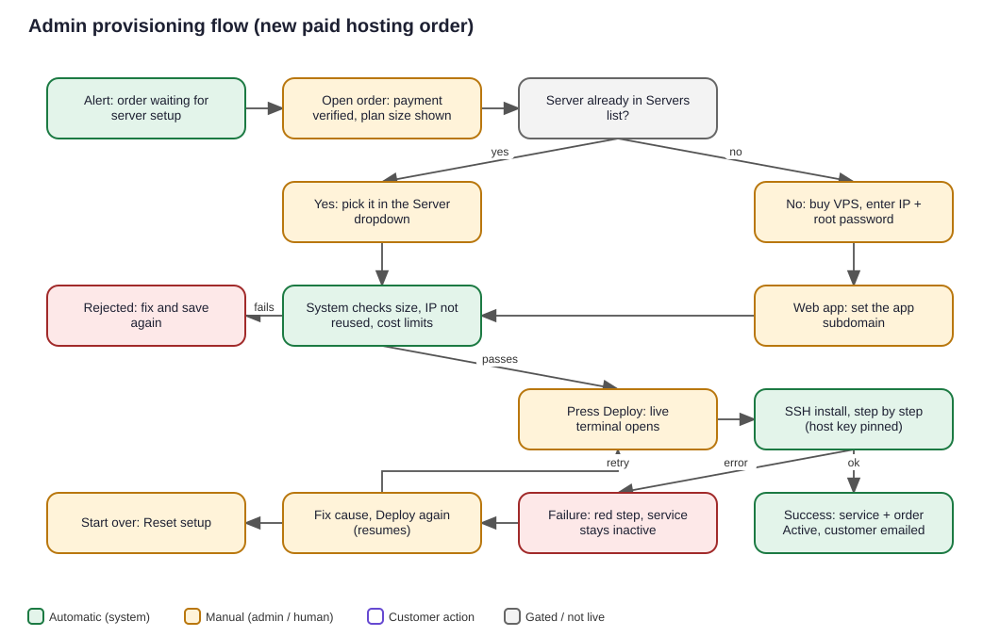

# DeveloperJet - Aasaan Guide (Website, Client Dashboard, Admin Panel)

Ye guide simple Hinglish mein hai, taaki owner, staff aur naya developer jaldi samajh sakein ki DeveloperJet kaise chalta hai. Technical detail ke liye `docs/03_COMPLETE_WORKFLOW.md` dekhiye.

> **Sabse zaroori sach:** order, billing, renewal, tickets aur deployment ka *software flow* bana hua hai aur tested hai. Lekin **asli VPS par automatic install abhi LIVE nahi hai.** Abhi deployment sirf "dry run" (practice) mode mein chalta hai. Real server par install, real payment (Razorpay) aur real Telegram owner approval ke baad hi on honge.

## 1. DeveloperJet kya hai

DeveloperJet (Powered by AmbitionHost) ek website hai jahan customer **AI tools ki hosting**, **developer VPS hosting** aur **digital services** kharidte hain.

Teen product groups hain:

| Group | Products | Kaise bikta hai |
|---|---|---|
| **AI Products** | Hermes CLI, Hermes Workspace, n8n, OpenClaw, Claude Code, AI Complete Bundle, AI All-Access | Plan choose karke order (approved price ho to) |
| **Developer Hosting** | Docker VPS Hosting | Plan choose karke order |
| **Digital Services** | WordPress, Laravel, Website, SEO, Business Automation | Pehle requirement form, phir quotation (koi auto charge nahi) |

**Managed vs Unmanaged:**
- **Managed:** server setup, security aur updates hamari team sambhalti hai. Customer ko application ka dashboard milta hai.
- **Unmanaged (Docker VPS):** hum Docker install karke server customer ko de dete hain. Root/SSH customer ke paas hota hai aur updates customer khud karta hai.

## 2. System ke teen hisse

| Hissa | Kaun use karta hai | Address |
|---|---|---|
| **Website** | Har visitor | `developerjet.com` |
| **Client Dashboard** | Registered customer | `developerjet.com/dashboard` |
| **Admin Panel** | Sirf staff | `developerjet.com/staff/developerjet/login` (Super Admin ye URL badal sakta hai) |

Customer aur staff ke login **alag-alag** hain. Staff ka login customer wale `/login` page se admin panel nahi kholta. `/admin` seedha kholne par bahar walon ko 404 milta hai.

## 3. Website par kya hai

- **Home page:** DeveloperJet kya karta hai aur delivery kaise hoti hai.
- **Products menu:** teen groups (AI Products, Developer Hosting, Digital Services).
- **Har product page:** ye kya hai, kiske liye hai, kya milega, kya nahi milega, kitne resources, deployment aur access kaise hoga, aur renewal ke niyam.
- **Pricing / Compare:** plans ki tulna (`/compare`).
- **Documentation:** 25 help articles (`/docs`), search ke saath.
- **Business Automation:** `/business-automation` par 3 plans aur requirement form.
- **Cart, Login, Get Started (Register).**

**Price ka niyam:** jis plan ka price owner ne approve nahi kiya, uspar "Pricing and resources to be confirmed" dikhta hai aur wo **order nahi ho sakta**. Koi bhi price code mein hard-code nahi hota, sab Admin se set hota hai.

## 4. Customer ka safar (step by step)

1. **Plan choose karna:** customer product page se plan cart mein daalta hai. Bina login ke bhi cart chalta hai, aur login karne par cart wahi rehta hai.
2. **Register karna:** naam, email, phone (+91 default) aur password.
3. **Email OTP:** 6 digit ka code email par aata hai. Verify hone tak checkout aur dashboard band rehte hain.
4. **Checkout:** managed/unmanaged, resources, billing period (monthly, quarterly, half-yearly, yearly) aur tax (agar set hai) dikhta hai. Saath mein ye bhi likha hota hai: *"delivery manual VPS assignment ke baad hoti hai, turant nahi."*
5. **Payment:** wallet se, ya Razorpay se (Razorpay abhi sirf test mode mein hai). Order "paid" tabhi hota hai jab server payment ko verify kar leta hai. Browser ki baat par bharosa nahi kiya jaata.
6. **Intezaar:** order "Awaiting VPS assignment" mein jaata hai aur admin team ko alert milta hai.
7. **Setup:** staff server assign karta hai, phir installation chalti hai.
8. **Service ready:** customer ko dashboard mein access details milti hain. Password kabhi email nahi hota.

## 5. Client Dashboard (customer kya dekhta hai)

| Menu | Kya hai |
|---|---|
| **Overview** | Services, orders, invoices aur tickets ka saar |
| **My Services** | Har service ka panel (neeche detail) |
| **Orders** | Saare orders aur unki timeline |
| **Invoices** | Paid invoices, PDF download |
| **Payments** | Payment history |
| **Subscriptions** | Renewal date, renewal invoice, cancellation request |
| **Wallet** | Balance aur ledger (balance kabhi minus nahi hota) |
| **Projects** | Digital services ke projects: milestones, approval, files, messages |
| **Quotes** | Digital services ke quotation: accept ya decline |
| **Tickets** | Support ticket kholna aur reply karna |
| **Profile** | Naam, phone, password, security |
| **Docs** | Help articles |

### My Services ka panel
- **6-step setup timeline:** Order Confirmed, Environment Preparing, Application Installing, Security Configuration, Final Verification, Ready to Use. Ye har 5 second mein khud update hoti hai.
- Product, plan, billing cycle, resources, renewal date aur service URL.
- Service active hone par **"Open application"** button.
- Is service ke invoices, health checks, aur renew / upgrade / ticket ke quick buttons.
- **Controls** (restart, console, backup, snapshot): abhi sab "Unavailable" dikhte hain, kyunki kisi supplier ka API verified nahi hai. Hum nakli button nahi dikhate.

## 6. Order ke baad andar kya hota hai (admin side)

1. **Paid order aata hai:** admin ko "VPS assignment required" alert milta hai.
2. **Server dhoondhna ya kharidna:** staff dekhta hai ki koi khaali server fit hota hai ya nahi. Nahi hota to supplier (DesiVPS, EricHost, Contabo, Server Broker) se **haath se** server kharidta hai.
3. **Server record karna:** Admin mein server ki IP, region, OS, CPU, RAM, disk, kharid ki keemat, supplier renewal date aur SSH fingerprint daali jaati hai. Root password kabhi plain text mein save nahi hota.
4. **Assign karna:** system khud check karta hai ki order paid hai, resources fit hain, managed/unmanaged match karta hai, aur cost/margin limit sahi hai. Ek order par sirf ek server lagta hai.
5. **Deployment:** recipe ke steps queue worker chalata hai.
   - **Dry run:** sab steps practice mein chalte hain, server ko chhuaa nahi jaata. *(Abhi yahi chalta hai.)*
   - **Live run:** asli server par commands chalti hain. *(Abhi BAND hai. SSH connector inert hai aur install commands approved nahi hain.)*
6. **Active:** sab steps aur validation pass hone par hi service aur order "Active" hote hain, aur customer ko notification jaati hai.
7. **Fail hone par:** service inactive rehti hai, admin ko alert jaata hai, aur cause theek karke retry kiya jaata hai. Retry pichhle complete steps ke baad se shuru hota hai.

## 7. Admin Panel (staff kya dekhta hai)

| Section | Kaam |
|---|---|
| **Dashboard** | KPI cards (revenue, orders, customers), 14 din ka graph, pending provisioning, open tickets |
| **User Manager** | Customers aur staff ek jagah: search, filter, email badalna, customer ki nazar se dekhna (read-only impersonation) |
| **Staff & roles, Departments** | Staff invite, suspend, roles aur permissions |
| **Orders** | Order timeline, notes, assign, cancel, refund workflow |
| **Infrastructure** | Providers, offers (cost vs selling price), servers, server pools |
| **Deployments** | Har install ka progress aur fail hua step |
| **Billing** | Subscriptions, renewals, overdue, failed renewals, suspension tasks |
| **Payments, Invoices, Wallet** | Paise ka hisaab |
| **Tickets** | Support queue, SLA, escalation |
| **Leads / Quote requests** | Business Automation aur digital services ki enquiries |
| **Plans, Categories, Add-ons** | Products aur price set karna (price approve karna) |
| **Documentation** | Help articles edit karna |
| **Notification log, Security & audit logs** | Kya bheja gaya, aur kisne kya badla |
| **Settings** | Company details, invoice, tax, SMTP email, Telegram, renewal niyam, staff login URL |
| **Exports** | CSV download (9 types) |

### Staff roles
**Super Admin, Administrator, Sales, Technical Support, Billing, Developer, SEO**, aur custom roles. Har role ko sirf zaroori cheezein dikhti hain. Jaise:
- Sales ko sirf apne leads dikhte hain.
- Technical Support server aur deployment dekh sakta hai, lekin server assign nahi kar sakta aur supplier ki cost bhi nahi dekh sakta.

**Super Admin** ke liye 2-step login (TOTP app) zaroori hai. SMTP, Telegram aur security settings sirf Super Admin badal sakta hai, wo bhi password dobara daalne ke baad.

## 8. Billing aur Renewal (aasaan bhasha mein)

- Har service ki ek **subscription** hoti hai jismein agli due date hoti hai.
- Due date se **7 din pehle** renewal invoice banta hai (ye din Settings se badle ja sakte hain).
- Reminder emails jaate hain: 7 din pehle, 3 din pehle, due date par, aur 1 din late hone par.
- **Card se automatic charge kabhi nahi hota.** Customer khud pay karta hai.
- Renewal hamesha **purchase ke samay wale price** par hota hai, naye list price par nahi.
- Late hone par: grace period (default 3 din), phir overdue, phir suspension ka **staff task** banta hai. Suspension apne aap nahi hota, staff supplier ke saath haath se karta hai.
- Pay karte hi service reactivate hoti hai. Data kabhi apne aap delete nahi hota.
- Service band hone par "retention review" task khulta hai.

## 9. Support Tickets

- Customer dashboard se ticket kholta hai (department, priority, attachment).
- Staff public reply karta hai ya **private note** likhta hai, jo customer ko kabhi nahi dikhta.
- SLA (jawab dene ka time) optional hai, escalation ke 3 level hain.
- Staff ko sirf apne department ke tickets dikhte hain.

## 10. Business Automation aur Digital Services

1. Customer `/business-automation` par form bharta hai (password ya API key kabhi nahi maangi jaati).
2. Usse ek reference number milta hai. Admin mein lead banti hai, aur customer ko acknowledgement, sales team ko email aur Telegram alert queue mein jaate hain.
3. Sales lead ko 10 steps mein le jaata hai: New, Reviewing, Assigned, Discussion, Quotation Prepared, Quotation Sent, Accepted/Declined, Converted to Project, Closed.
4. Customer quotation accept kare to project banta hai (milestones, files, messages). **Accept karne se koi charge nahi hota.**

## 11. Kya automatic hai, kya manual, kya abhi band

| Kaam | Status |
|---|---|
| Registration, OTP, login | ✅ Automatic (SMTP set hone par email jaata hai) |
| Cart, checkout, wallet payment | ✅ Automatic |
| Razorpay payment | 🟡 Bana hua hai, sirf test fakes par chala hai. Real account par nahi chala |
| Order ka paid hona aur admin alert | ✅ Automatic |
| Supplier se VPS kharidna | 👤 Manual (staff) |
| Server assign karna | 👤 Manual (staff), checks automatic |
| Deployment dry run | ✅ Automatic |
| **Asli server par install** | ⛔ **Band.** Owner approval aur test VPS chahiye |
| Renewal invoice aur reminders | ✅ Automatic (cron aur queue chalna zaroori) |
| Suspension / reactivation supplier par | 👤 Manual (staff task banta hai) |
| Tickets, projects, leads | ✅ Bana hua aur tested |
| Telegram alerts | 🟡 Bana hua hai, real bot se test nahi hua |
| Restart / console / backup buttons | ⛔ Abhi Unavailable (supplier API verified nahi) |

## 12. Go-live se pehle zaroori kaam (owner checklist)

1. **SMTP email set karna** (server `.env` mein `MAIL_MAILER=smtp`, ya Admin → Settings → Email). Iske bina OTP aur staff login ka email code nahi jaata.
2. **Queue aur scheduler cron lagana** (cPanel → Cron Jobs). Iske bina renewals aur reminders nahi chalenge. Steps `docs/CPANEL_DEPLOYMENT_GUIDE.md` mein hain.
3. **Prices approve karna:** har plan ka price aur resources Admin → Plans mein.
4. **Company details, GST/tax, invoice prefix** Settings mein.
5. **Telegram bot** token aur chat ID set karke test karna.
6. **Razorpay** ka sandbox test, phir live keys (owner approval ke saath).
7. **Real install** ke liye ek disposable test VPS par recipe-wise testing, aur uske baad hi live switch on karna.

## 13. Roz ka kaam (staff ke liye)

- **Subah:** Admin Dashboard par pending provisioning, open tickets aur overdue renewals dekhiye.
- **Naya paid order:** server assign kijiye, dry run chalaiye, aur jab live approved ho tab deploy kijiye.
- **Billing tab:** failed renewals aur suspension tasks dekhiye.
- **Leads:** naye Business Automation requests ka follow-up kijiye.
- **Supplier renewals:** jis server ki supplier renewal date paas ho, uska alert dekhiye.

## 14. Problem aaye to

| Problem | Hal |
|---|---|
| Staff login par "Confirm your email" aur code nahi aaya | Server par SMTP set nahi hai. `.env` mein `MAIL_MAILER=smtp` aur SMTP details daalein, phir `php artisan config:cache` chalayein aur "Send a new code" dabayein |
| Customer ko OTP nahi mila | Wahi SMTP wali baat. Spam folder bhi check karein |
| Site par ajeeb popup ("Verify you're human, press Win+R") | Ye hack hai. Cloudflare → Workers Routes check karein, anjaan worker delete karein aur API tokens revoke karein |
| Renewal invoice nahi bana | Cron (`schedule:run`) aur queue chal rahe hain ya nahi, check karein |
| Deployment fail hua | Admin → Deployments mein fail hua step dekhein, cause theek karein, phir retry karein |
| Staff login URL bhool gaye | Server par `php artisan staff:portal --show` chalayein |

---

*Ye guide sirf wahi batati hai jo code mein bana hai aur locally test hua hai. Production par jo verify nahi hua (real payment, real install, real Telegram), use saaf-saaf "band" ya "test nahi hua" likha gaya hai.*
