# DeveloperJet Admin Panel Guide

Ye guide admin panel ka **har section** samjhati hai: wo kis liye hai, usme kya dikhta hai, kaun se button hain, aur roz ka kaam kis kram mein hota hai. Har section ke saath us page ka screenshot hai.

> **Screenshots ke baare mein:** sab screenshots ek local test database ke hain. "Rahul Sharma", `example.test` emails aur `203.0.113.x` IP nakli hain. Aapke live panel par aapka asli data dikhega, layout wahi rahega.

## 1. Sabse pehle: login, sidebar aur upar ki bar

### Staff login

- Staff ka login page **`https://developerjet.com/staff/developerjet/login`** hai. `/admin/login` ab hai hi nahi.
- Jo staff login nahi hai, use `/admin` par **404** milta hai, taaki bahar ke log admin panel dhoondh hi na sakein.
- Login: email + password. 5 galat try par 5 minute ka lock.
- Agar 2-step (authenticator app) laga hai to code bhi maanga jaata hai.
- Pehli baar login par email par aaya 6 digit code daalna padta hai.
- Super Admin ke liye 2-step **zaroori** hai.
- Login URL badalna ho to *Settings → Staff login URL*. Lock ho jaayein to server par `php artisan staff:portal --show` ya `--reset` chalaayein.

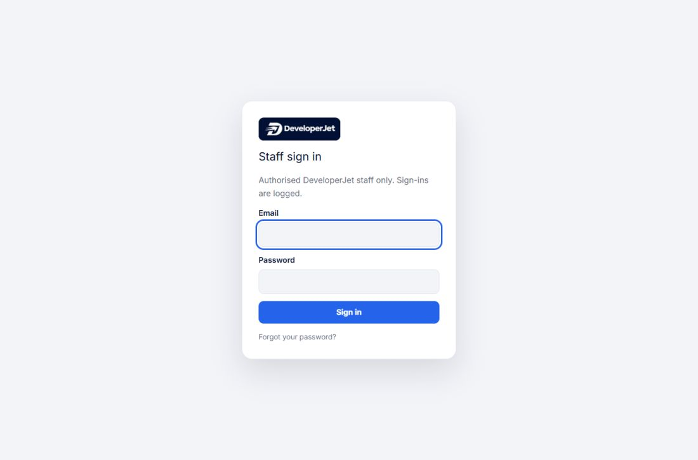

### Sidebar

Sidebar ke do hisse hain:

| Hissa | Kya hai |
|---|---|
| **Daily** | Roz ka kaam: Dashboard, Orders, Servers, User Manager, Support tickets, Wallet, Payments, Invoices, Products & plans, Settings |
| **More** (`+` dabaake khulta hai) | Kabhi-kabhi ka kaam: Deployments, Staff & roles, Billing, Infrastructure, Leads, Projects, SEO, Docs, Logs, Exports, aur baaki |
| **Account** | My profile (naam, password), My security (2-step), Staff portal URL (sirf Super Admin) |

- Har staff ko sirf wahi menu dikhte hain jinki usse permission hai.
- Permission ki asli jaanch server par hoti hai, isliye seedha link khol ke bhi koi bina permission page nahi dekh sakta.

### Upar ki bar

- **Search users…:** kisi bhi customer ko naam, email ya phone se dhoondho. Keyboard par `/` dabaane se search box khul jaata hai.
- **◐ button:** light aur dark theme badalta hai.
- **Ghanti (🔔) aur laal number:** jo kaam aapka intezaar kar raha hai, uski ginti:

| Ghanti mein line | Kahan le jaati hai |
|---|---|
| Pending wallet top-ups | Wallet (customer ka paisa confirm karna hai) |
| Orders awaiting provisioning | Orders (server setup karna hai) |
| Open tickets | Support tickets (jawab dena hai) |
| Refunds pending | Orders (refund poora karna hai) |
| Open billing actions | Billing (suspend/reactivate karna hai) |
| New Automation leads | Leads (naye sales lead) |
| Failed notifications | Notifications (email ya Telegram fail hua) |

- Upar se aane wale **hare message** 6 second mein khud hat jaate hain.
- **Laal message** (error) tab tak rehta hai jab tak aap use band na karein.

## 2. Roz ka poora workflow (order se delivery tak)

Ye DeveloperJet ka sabse zaroori kaam hai. Ek nazar mein:

| # | Kaun | Kahan | Kya karna hai |
|---|---|---|---|
| 1 | Client | Website | Plan chunta hai (monthly/yearly) aur pay karta hai (Razorpay ya wallet). Web apps (n8n, Workspace) mein subdomain de sakta hai, ye zaroori nahi hai |
| 2 | System | — | Order **Awaiting Provisioning** mein aata hai. Ghanti aur dashboard par "Orders waiting for server setup" dikhta hai. Admin ko email/Telegram jaata hai |
| 3 | Aap | Bahar | Order ke plan jitna VPS supplier se kharido (DesiVPS, Contabo wagaira). Supplier ki email mein IP aur root password aata hai |
| 4 | Aap | Order page → **Step 1** | VPS IP + root password daalo. n8n/Workspace ho aur client ne subdomain na diya ho to subdomain bhi. **Save** |
| 5 | Aap | DNS | Subdomain ka **A record** VPS IP par point karo (sirf web apps) |
| 6 | Aap | Order page → **Step 2** | **▶ Deploy** dabao. Live terminal khulta hai |
| 7 | System | VPS | Security, Docker, app, HTTPS sab apne aap install hota hai (5–20 minute) |
| 8 | System | — | Install poora hote hi service **Active**, order **Active**, client ko email |
| 9 | Client | Dashboard | IP, root login, app link, live usage, reboot aur password change: sab uske panel mein |

> **Galti ho jaaye to:** Step 1 mein **Reset setup (Start over)** se server aur subdomain hata ke dobara shuru karo. VPS par kuch delete nahi hota. Install fail ho to terminal mein laal line dikhegi; theek karke **Deploy again** dabao. Pehle ho chuke steps dobara nahi chalte.

## 3. Dashboard

**Kis liye:** business ka ek nazar mein haal, aur aaj kya karna hai.

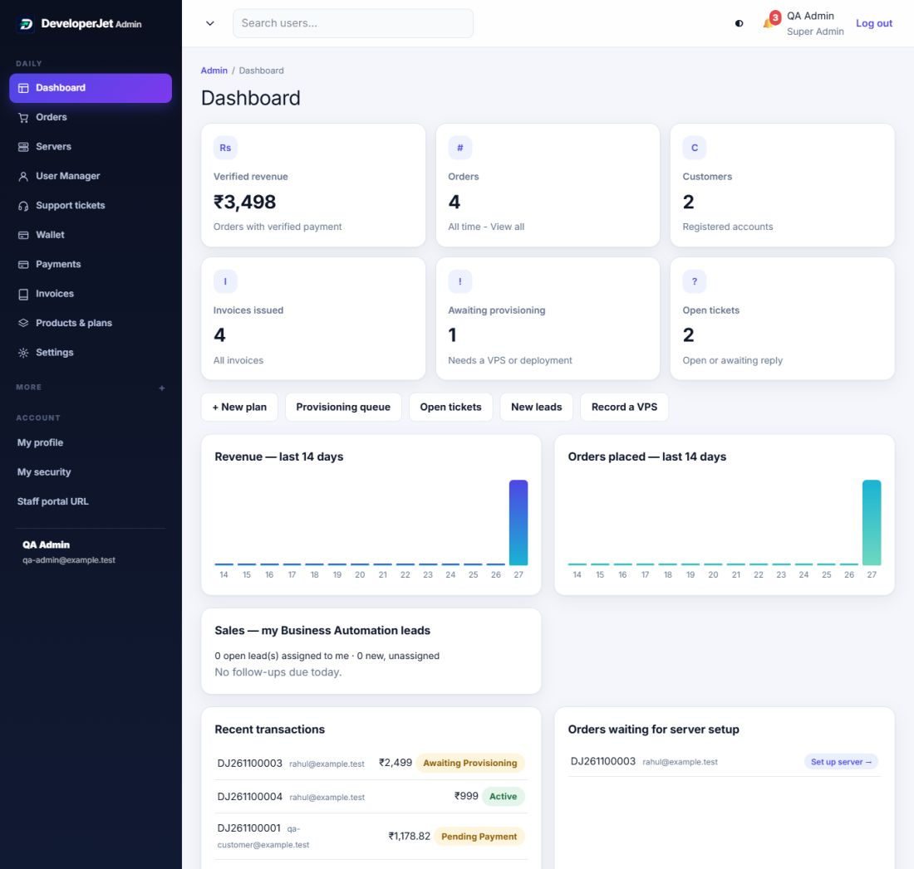

| Hissa | Matlab |
|---|---|
| Verified revenue | Jin orders ka payment verify ho chuka hai unka total (sirf `payments.view` wale staff ko) |
| Orders / Customers / Invoices issued | Kul ginti |
| **Awaiting provisioning** | Kitne orders ke liye server setup baaki hai. Ye sabse zaroori number hai |
| Open tickets | Jin tickets ka jawab dena baaki hai |
| Quick buttons | + New plan, Provisioning queue, Open tickets, New leads, Record a VPS |
| Charts | Pichhle 14 din ka revenue aur orders |
| Sales card | Aapke assigned leads aur aaj ke follow-up |
| Recent transactions | Aakhri 8 orders |
| **Orders waiting for server setup** | Har order ke saath **Set up server →** link, jo seedha order page ke Step 1 par le jaata hai |
| Pending tickets, Recent deployments | Turant dekhne layak |

## 4. Orders (sabse zaroori page)

**Kis liye:** saare orders dekhna, aur har order ko server dekar deliver karna.

**List:** order number ya email se search karo. Status se filter karo, ya "Assigned to me" chuno.

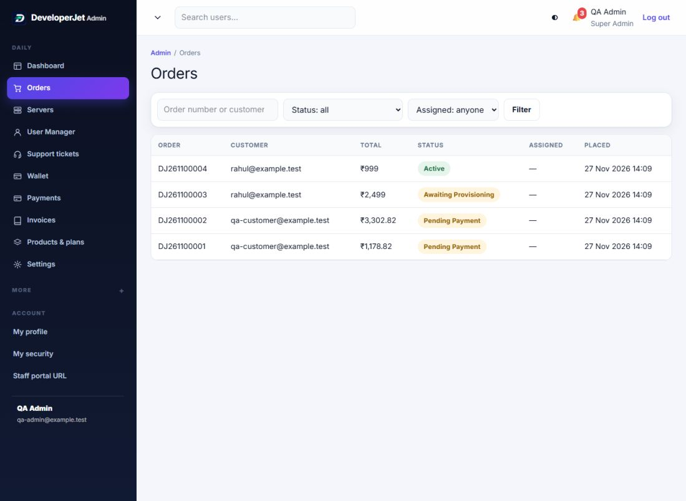

### Order page: upar ka hissa

- Customer, plan (monthly/yearly), total, kab paid hua aur kaise (wallet/Razorpay), kab place hua. Sab apne aap bhara hota hai.
- **Assign:** order kisi staff ko de sakte ho.

### Step 1: Server & address

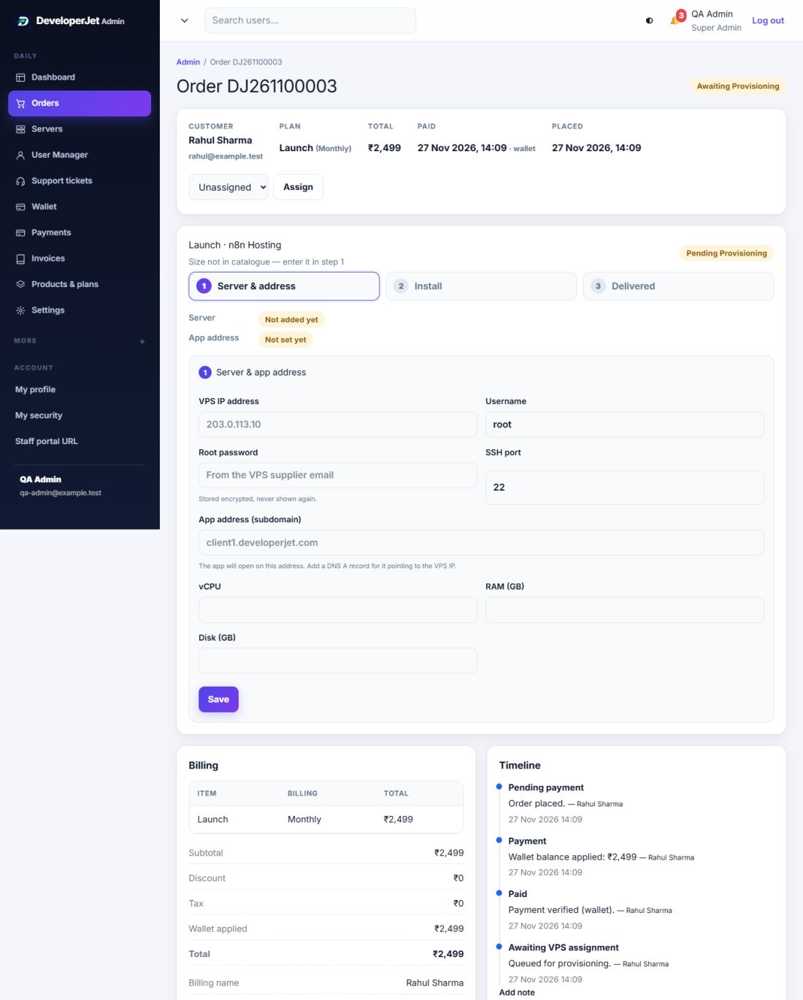

| Field | Kya daalna hai |
|---|---|
| VPS IP address | Supplier ki email wala IP |
| Username | Aam taur par `root`, pehle se bhara hai |
| Root password | Supplier ki email wala password. Ye **encrypted save** hota hai aur dobara kabhi nahi dikhta. SSH key bhi chalegi |
| SSH port | Aam taur par `22` |
| App address (subdomain) | Sirf n8n/Workspace/OpenClaw/Bundle ke liye, jaise `client1.developerjet.com`. Har service ka alag hona chahiye |
| vCPU / RAM / Disk | Sirf tab maanga jaata hai jab plan mein size likha na ho. Warna plan se apne aap aata hai |

**Rules:**
- Jo IP kisi doosre client ki service par laga hai, wo dobara nahi lagta.
- IP badalne par purana "host fingerprint" hat jaata hai.
- Pehle se inventory mein pada server bhi dropdown se chun sakte ho.

### Step 2: Install (Deploy aur live terminal)

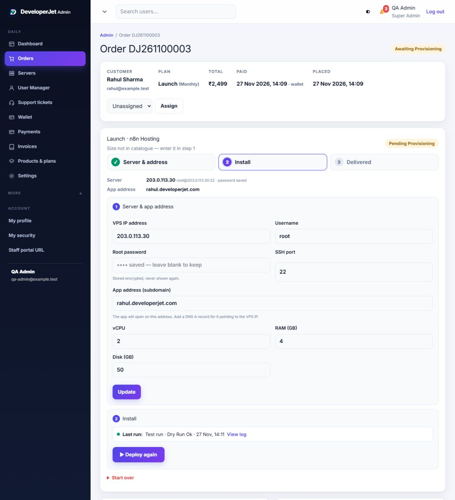

- **▶ Deploy** dabane par confirm poochha jaata hai, phir **live terminal** khulta hai.
- Jab tak install chal raha hai, button **⏳ Installing…** dikhata hai aur dabta nahi. Isse do baar install nahi hota.
- Terminal har step dikhata hai: SSH check → OS check → security → Docker → app → health check.
- Password aur keys terminal ya log mein **kabhi nahi** likhe jaate.

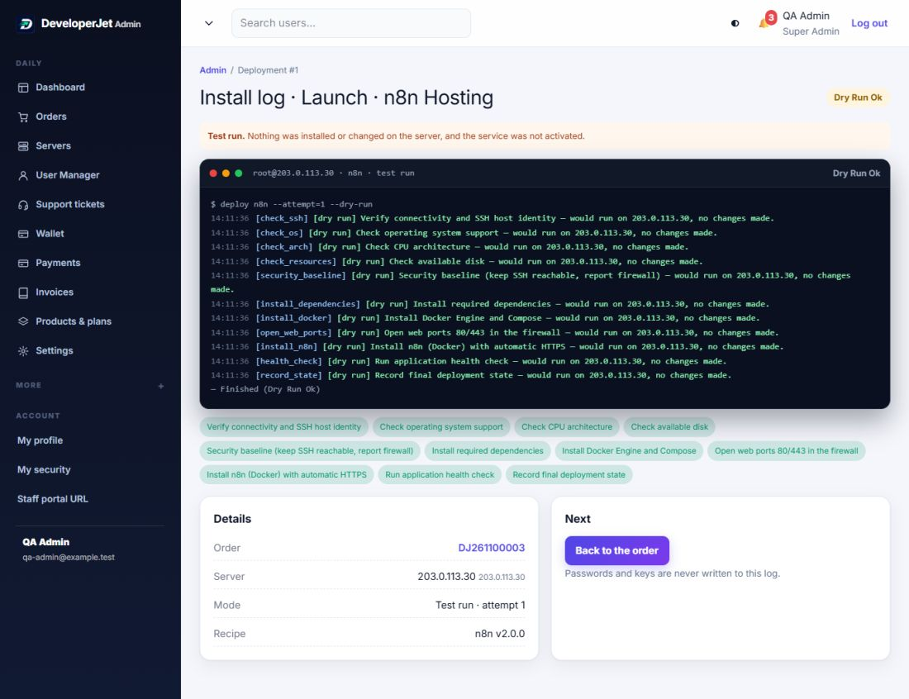

> **Automatic install ON/OFF:** aapke live server par `PROVISIONING_LIVE_ENABLED=true` hai, isliye Deploy asli install karta hai. Agar ye OFF ho, to Deploy sirf **test run** karta hai ("Nothing was installed") aur page par "I installed it myself — mark delivered" button aata hai.
>
> Hermes Workspace, OpenClaw aur AI Complete Bundle ke installer abhi bane nahi hain. In par Deploy un steps par ruk jaata hai, aur abhi "mark delivered" wala manual tareeka hi hai.

### Step 3: Delivered (server ke buttons)

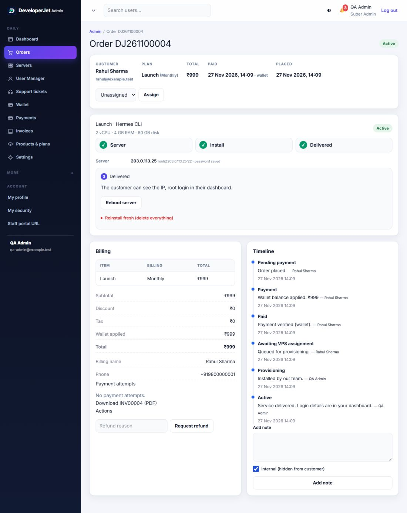

Service Active hone ke baad ye buttons milte hain (product ke hisaab se):

| Button | Kya karta hai | Client ko bhi milta hai? |
|---|---|---|
| Reboot server | Poora VPS restart, 1–2 minute | Haan |
| Restart app | Sirf app (jaise n8n) restart | Haan |
| Reset app login | n8n ka password bhool gaya ho to owner account dobara banana. Workflows bache rehte hain | Haan |
| **Suspend** | App band karta hai, data bacha rehta hai. Payment na aaye tab | Nahi (sirf admin) |
| **Unsuspend** | App wapas chalu | Nahi |
| **Reinstall fresh (delete everything)** | App aur uska saara data delete karke naya install. OS ko nahi chhoota | Haan, `REINSTALL` type karke |

Suspend aur Reinstall ke liye `servers.edit` permission bhi chahiye.

### Neeche: Billing, Timeline, Refund

- **Billing card:** items, discount, tax, wallet se kitna kata, total, billing naam/phone/GSTIN, payment attempts, invoice PDF.
- **Cancel order:** sirf unpaid order, reason zaroori.
- **Request refund → Complete refund:** paisa client ke wallet mein, ya "gateway se manually refund kiya" chuno. Credit note apne aap banta hai. Complete karne ke liye refund + approve dono permission chahiye.
- **Timeline:** order ki poori kahani. **Add note** se note likho; "Internal" tick ho to client ko nahi dikhta.

### AI All-Access order

AI plans mein server nahi hota. Order page par 3 step dikhte hain:

1. ModelGo console mein key banao.
2. Key + Base URL yahan paste karke **Deliver** dabao.
3. Client apne dashboard mein key dekhta hai.

- Key encrypted save hoti hai aur email mein kabhi nahi jaati.
- Suspend karne par DeveloperJet mein band hota hai. **ModelGo console mein key alag se band karni padti hai.**

## 5. Servers

**Kis liye:** saare VPS ki list (inventory): kaunsa server kis client ke paas hai, kab renew hona hai.

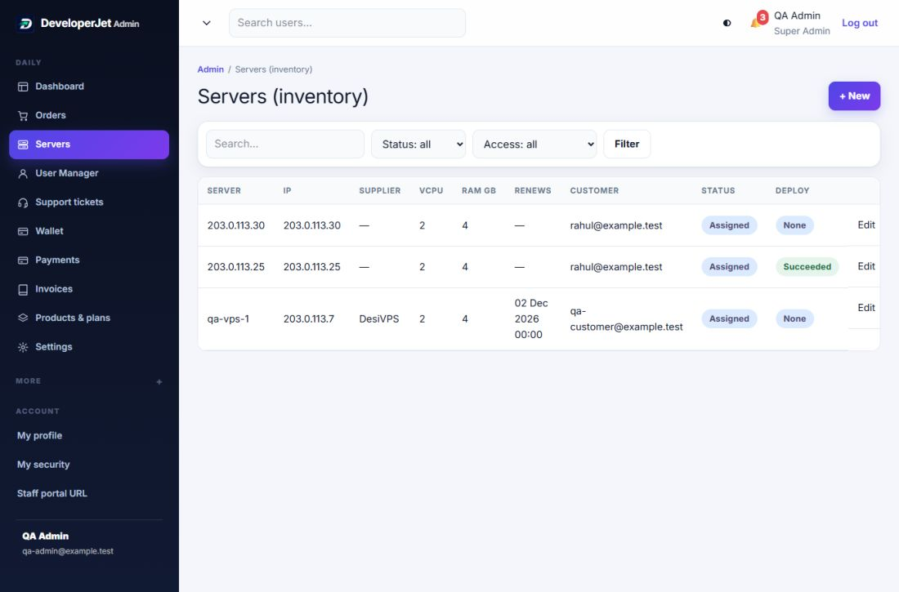

- **Columns:** label, IP, supplier, vCPU, RAM, renew date, customer, status, deploy status. Kharid ka daam sirf `supplier_costs.view` wale staff ko dikhta hai.
- **Add / Edit / Delete.** Zaroori fields pehle dikhte hain, baaki "More details" mein band rehte hain.
- Password field mein kuch na daalo to purana password hi rehta hai. Password kabhi wapas dikhta nahi.
- Jo server kisi client ko diya hua hai, wo delete nahi hota.
- Aam taur par server yahan se add karne ki zaroorat nahi padti. Order page ka Step 1 khud server bana deta hai.

## 6. User Manager (customers)

**Kis liye:** customers aur staff ki poori list, aur kisi customer ka poora record.

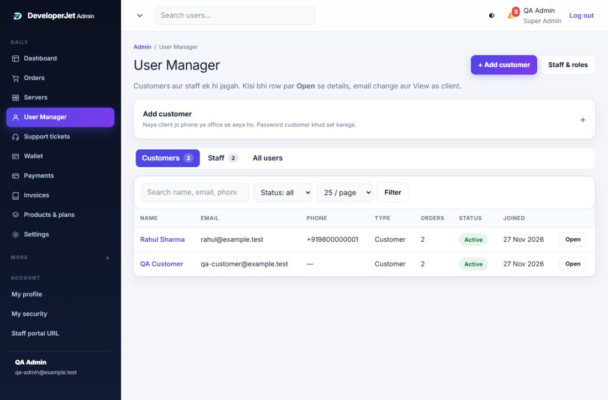

- **Tabs:** Customers, Staff, All users. Naam, email ya phone se search; status aur role se filter.
- **+ Add customer:** naam, email, phone. Chaho to customer ko "password set karo" link email ho jaata hai. Staff kabhi customer ka password nahi dekhta ya rakhta.
- **Customer page par:** kitne orders, services, invoices, tickets, aur haal ke orders/tickets.
- **Change email:** password dobara poochha jaata hai. Email unverified ho jaati hai.
- **View as client:** customer ka dashboard waise hi dekho jaise use dikhta hai. Ye **sirf dekhne** ke liye hai; is dauraan koi save ya submit nahi hota. Shuru aur band dono log hote hain.

## 7. Support tickets

**Kis liye:** client ki problems ka jawab dena.

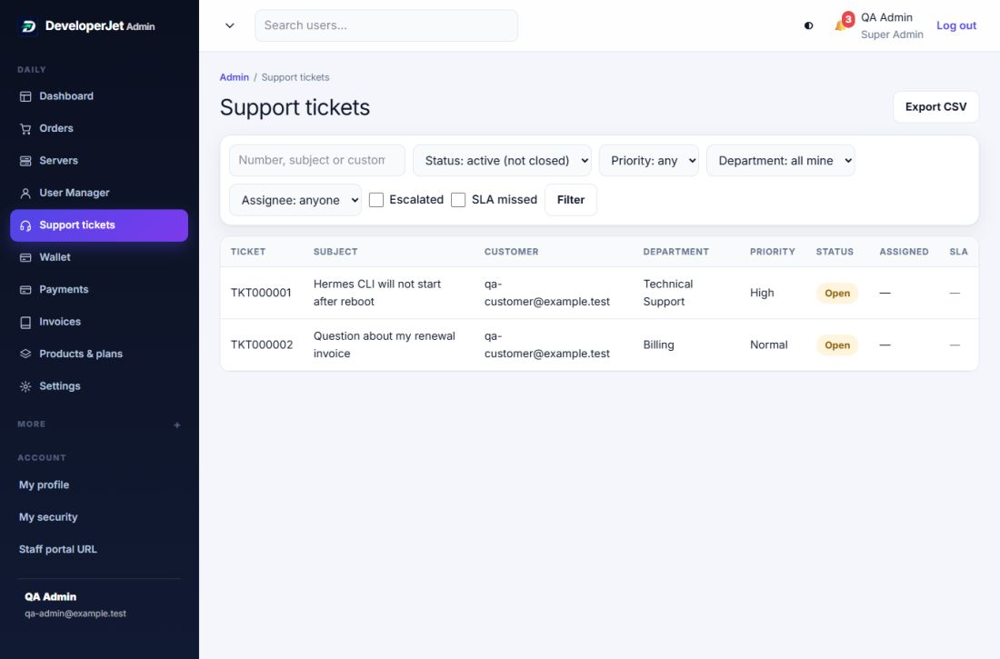

- Staff ko sirf apne department ke tickets dikhte hain. Super Admin ko sab.
- **Filter:** status, priority, department, "mine/unassigned", escalated, SLA missed. Number, subject ya customer se search.
- **Ticket ke andar:**
  - **Reply:** client ko jawab. Ya **private note:** sirf staff ke liye. Har baar 3 file tak (jpg/png/pdf/txt/zip, 5 MB).
  - **Assign:** kisi staff ko do. **Move:** doosre department mein bhejo.
  - **Status / Priority** badlo. **Escalate:** reason ke saath upar bhejo.
  - SLA (kitne ghante mein jawab dena hai), activity log, aur client ke baaki tickets bhi dikhte hain.
- **Export CSV:** `tickets.export` permission ho to.

## 8. Wallet

**Kis liye:** client ka wallet balance. Client UPI/bank se paisa bhejta hai, aap verify karke credit karte ho.

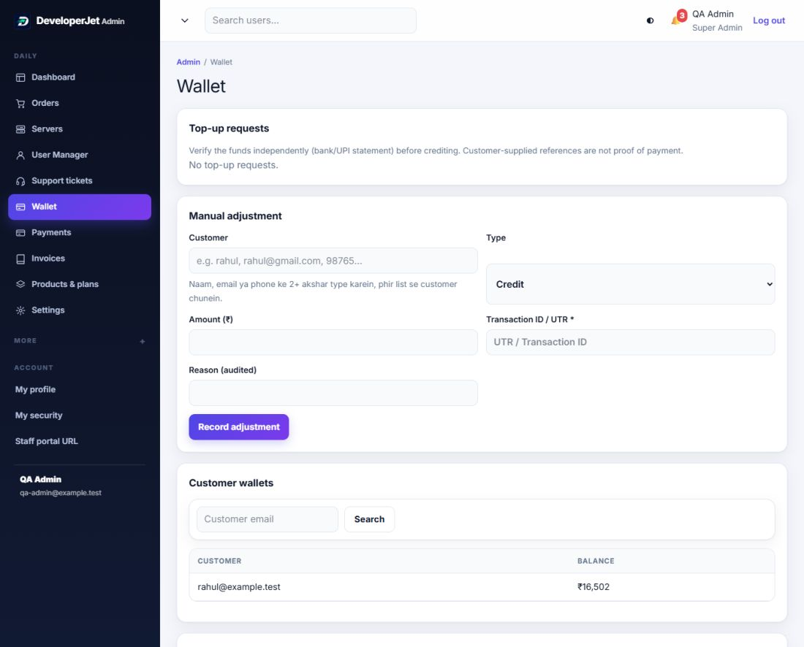

**Top-up requests (client ki request):**
- **Credit:** amount confirm karo. Paisa sirf ek baar credit hota hai, do baar click se bhi double nahi hota.
- **Reject:** reason zaroori.
- **Dhyan:** client ka diya UTR number saboot nahi hai. **Pehle apne bank/UPI statement mein paisa aaya hai ye dekho**, phir credit karo.

**Manual adjustment (khud credit/debit):**
- Customer dhoondho → Credit ya Debit → amount.
- **Transaction ID / UTR zaroori** hai aur har baar alag hona chahiye.
- **Reason zaroori** hai (kam se kam 5 akshar). Ye audit log mein jaata hai.
- Balance se zyada debit nahi hota.

**Neeche:** sab customers ke balance, aur wallet ki poori history: kisne kab kitna add kiya.

## 9. Payments, Invoices, Subscriptions

**Payments: Razorpay/wallet ke saare payment attempts.** Ye page sirf padhne ke liye hai. Status filter mein `amount_mismatch` bhi hai, yaani jitna aana tha utna nahi aaya.

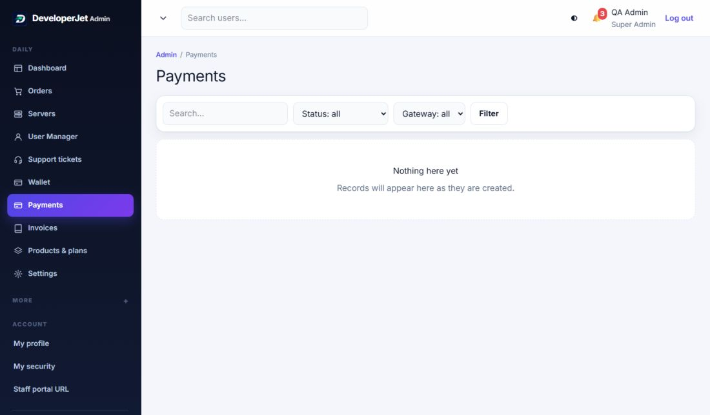

**Invoices: saari invoices aur credit notes.** Har line ke saath PDF download. Ye bhi sirf padhne ke liye hai, kyunki invoice system khud banata hai.

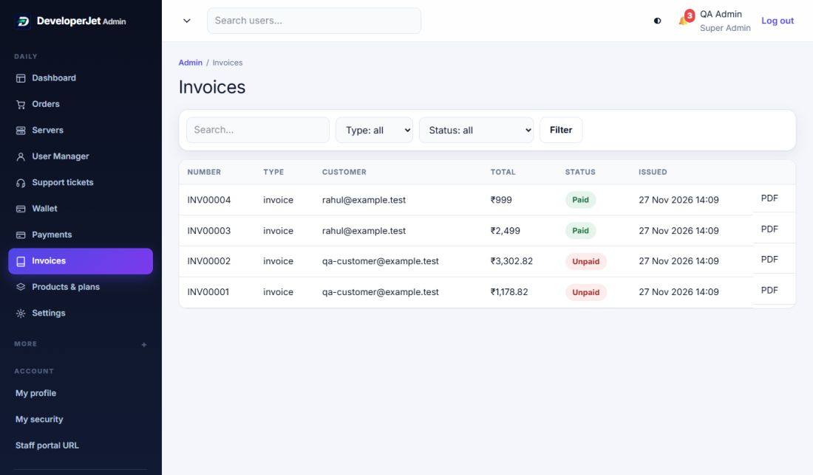

**Subscriptions (More menu): har chalu plan ki renewal.** Status se filter. Asli kaam *Billing & renewals* page par hota hai.

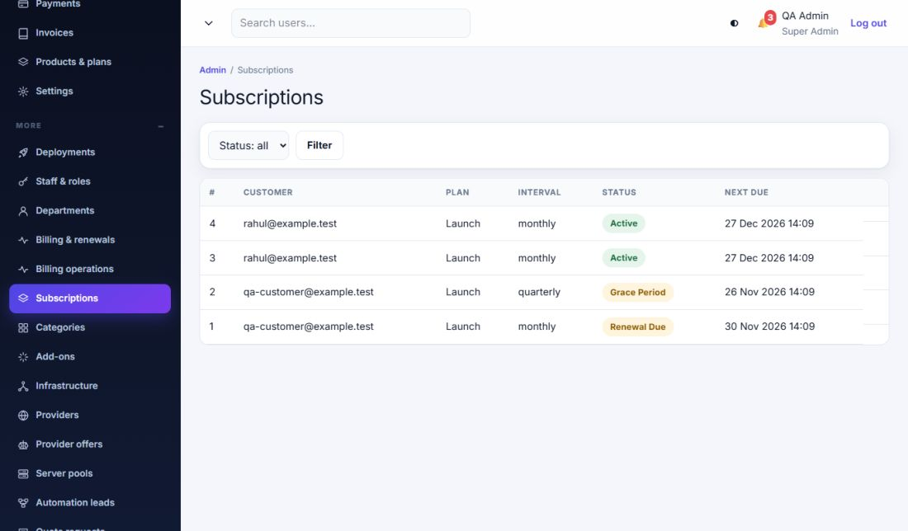

## 10. Products & plans

**Kis liye:** website par jo plans bikte hain, unke naam, features, CPU/RAM aur daam.

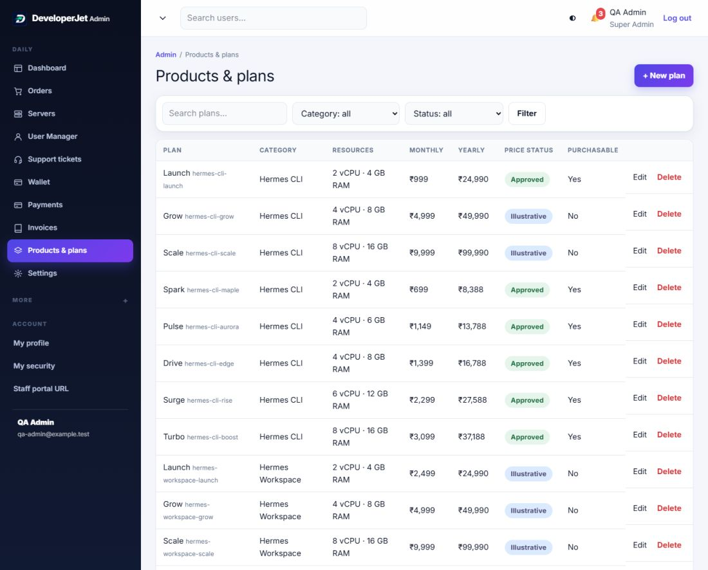

**Plan form ke hisse:**

| Hissa | Kya hai |
|---|---|
| Basics | Naam, slug, category, product type, tagline, description, features, "not included", comparison table |
| Resources | vCPU / RAM / disk / bandwidth, ya ek resource profile |
| Pricing | Monthly, 3, 6 aur 12 mahine: daam, discount, setup fee, Available, Approved |
| Availability | Visible/hidden, stock, order, active, featured, **purchasable** |

**Daam ke rules (galti se galat daam na bike, isliye):**
- Daam ko **Approved** sirf `plans.approve` wala (aap, Super Admin) kar sakta hai. Koi aur daam badle to wo period phir se "pending" ho jaata hai.
- **Purchasable** tabhi ON hota hai jab daam approved ho aur monthly daam ho.
- Jis plan ke orders hain, use delete karne par wo sirf band (deactivate) hota hai, mitta nahi.
- Purane orders aur subscriptions apna purana daam hi rakhte hain.

**Categories** aur **Add-ons** (More menu) bhi isi tarah edit hote hain. Add-on ka daam bhi sirf `plans.approve` wala set kar sakta hai.

## 11. Settings

**Kis liye:** company details, payment, billing ke rules, email/Telegram, support SLA aur security. Har section alag save hota hai.

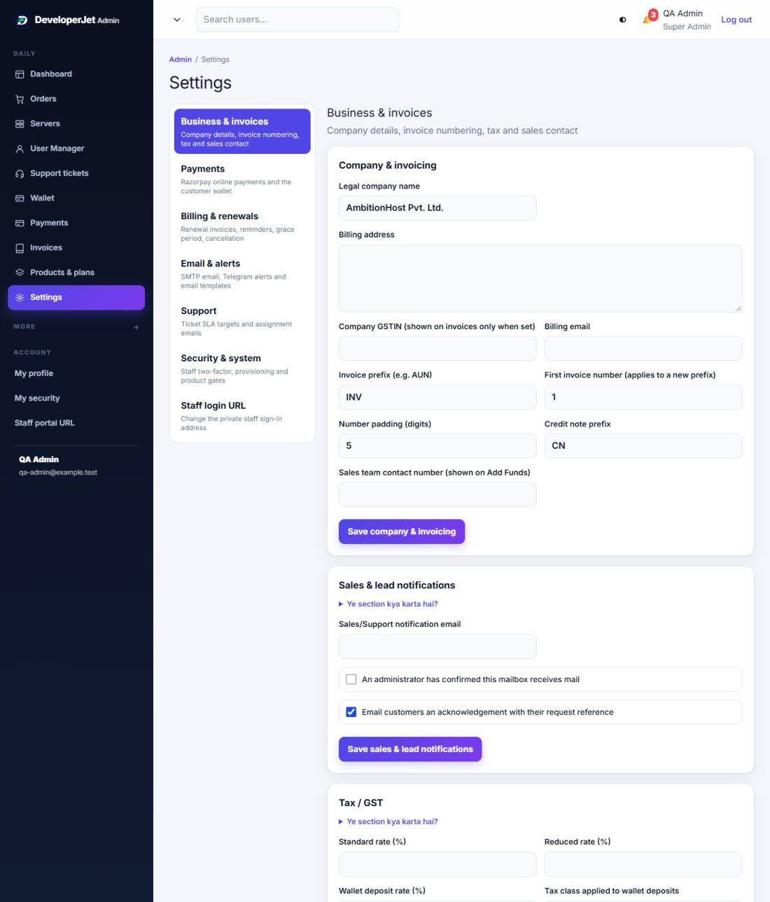

| Tab | Kya set hota hai |
|---|---|
| **Business & invoices** | Company naam, address, GSTIN, billing email, invoice prefix aur number, tax rates, sales phone, sales notification email |
| **Payments** | Razorpay ON/OFF, test/live, key ID, key secret, webhook secret (webhook URL bhi yahin likha hai). Wallet hamesha ON |
| **Billing & renewals** | Due date se kitne din pehle invoice (7), reminders (7 aur 3 din pehle), overdue reminder, grace days (3), auto-suspend (OFF), suspend se pehle approval (ON), cancellation ke rules |
| **Email & alerts** | SMTP (email server), Telegram bot, kaunse events par Telegram aaye, email templates. **Send a test** button se check karo |
| **Support** | Urgent, high, normal aur low ticket ka jawab kitne ghante mein |
| **Security & system** | Sab staff ke liye 2-step zaroori, provisioning mode, server ka max cost aur min margin |
| **Staff login URL** | Staff login ka link badalna (sirf Super Admin, password + 2-step code ke saath) |

- Password/secret wale fields **sirf likhne** ke liye hain. Khaali chhodo to purana value rehta hai, aur wo kabhi dikhta nahi.
- SMTP, Telegram aur Security sirf **Super Admin** save kar sakta hai, wo bhi password dobara daal ke.

## 12. Billing & renewals aur Billing operations (More menu)

### Billing & renewals

**Kis liye:** kis client ki renewal kab hai, kaun late hai, kise suspend ya reactivate karna hai.

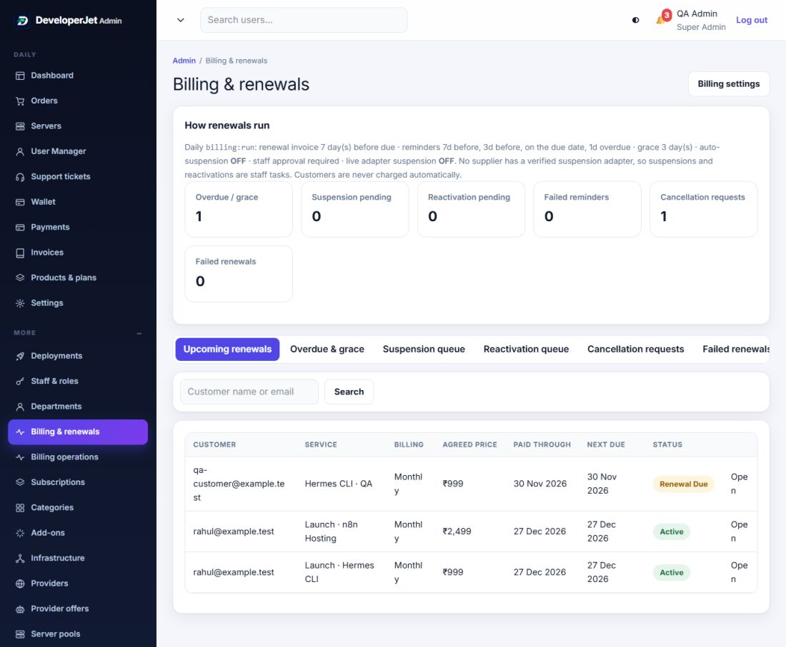

> **Sabse zaroori rule:** client ka paisa **kabhi apne aap nahi kata jaata**. System renewal invoice banata hai aur reminder bhejta hai; client khud pay karta hai.

- **Tabs:** Upcoming, Overdue & grace, Suspension queue, Reactivation queue, Cancellation requests, Failed renewals, Cancelled & expired, Reminder log, All.
- **Cancellation requests:** Approve, ya Reject (note zaroori).
- **Subscription kholne par:**
  - **Issue renewal invoice now:** turant invoice bhejo.
  - **Exempt:** is client ko auto-suspend se bachao.
  - **Queue suspension → Confirm suspended**, aur **Confirm reactivated**. Har ek par confirmation tick zaroori.
  - **Change agreed price:** agle invoice se naya daam, reason zaroori.
  - **Add recurring add-on:** agreed daam par.
  - **Run renewal processing now:** jo kaam roz subah 8 baje apne aap hota hai, wo abhi chalao.
- Supplier ki taraf VPS band/chalu karna abhi **staff ka kaam** hai, kyunki kisi supplier ka API juda nahi hai. Client ka app band karne ke liye order page ka **Suspend** button use karo.
- Kuch bhi delete nahi hota. Proration (bache dino ka hisaab) apne aap nahi hota.

### Billing operations

**Kis liye:** paise ka hisaab-kitaab check karna.

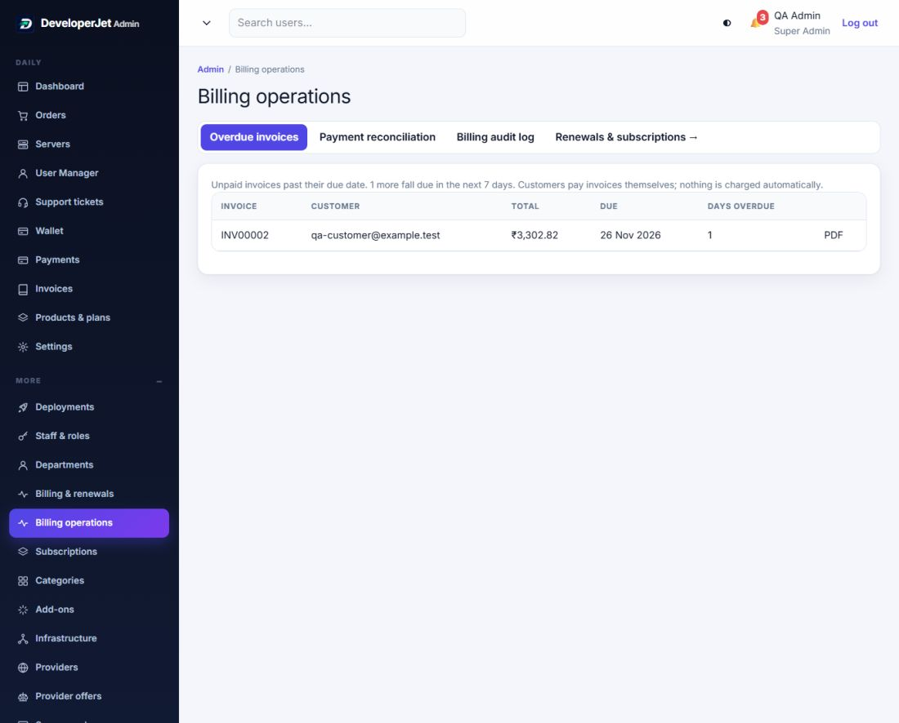

- **Overdue invoices:** kitne din late, PDF.
- **Payment reconciliation:** 10 minute se atke payments, amount mismatch, verify hue par settle nahi hue, paid order bina invoice. **Run reconciliation now** (do baar chalane se kuch kharab nahi hota).
- **Billing audit log:** billing mein kisne kya badla.

## 13. Staff & roles (More menu)

**Kis liye:** team banana aur kaun kya kar sakta hai, ye tay karna.

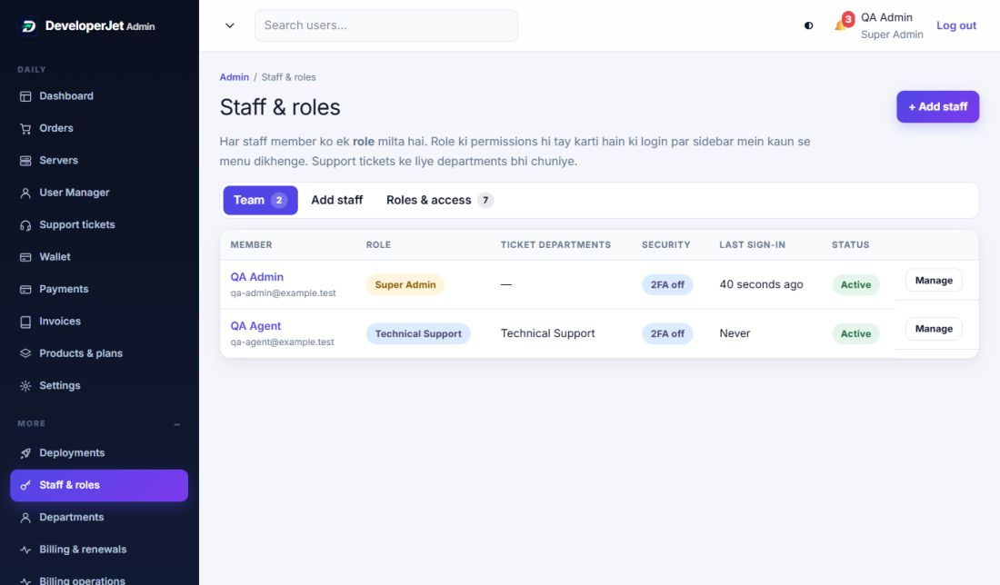

- **Team:** har staff ka role, department, 2-step ON/OFF, last login, status.
- **Add staff:** **Invite by email** (behtar: staff khud password banata hai, link 72 ghante chalta hai), ya temporary password (12+ akshar; pehli login par badalna padta hai).
- **Staff kholne par:** role/department badlo, **Suspend** (reason ke saath; turant logout), Reactivate, sab sessions se logout, **Reset access** (naya password ya 2-step reset).
- **Rules:**
  - Koi khud ko suspend nahi kar sakta.
  - Kam se kam ek Super Admin hamesha active rehta hai.
  - Super Admin ko sirf Super Admin badal sakta hai.

**Roles (pehle se bane hue):**

| Role | Kya kar sakta hai |
|---|---|
| Super Admin | Sab kuch |
| Administrator | Orders, servers, deploy, customers, plans (daam approve nahi), tickets, leads, projects. Staff, settings ya security logs nahi |
| Billing Staff | Payments, wallet credit/approve, invoices, subscriptions dekhna |
| Technical Support | Tickets ka jawab, orders aur servers dekhna |
| Sales Staff | Leads, projects, customers dekhna |
| Developer | Projects, servers dekhna, **deploy** |
| SEO Manager | SEO aur projects |

**Departments** (More menu): General, Billing, Technical Support, Sales, Development, SEO. Har department ka alert email aur SLA ghante set hote hain.

## 14. Deployments aur Infrastructure (More menu)

### Deployments

**Kis liye:** ab tak ke saare install ki list: kaunsi service, kaunsa server, test run ya live, safal ya fail. **Open** se wahi live terminal khulta hai.

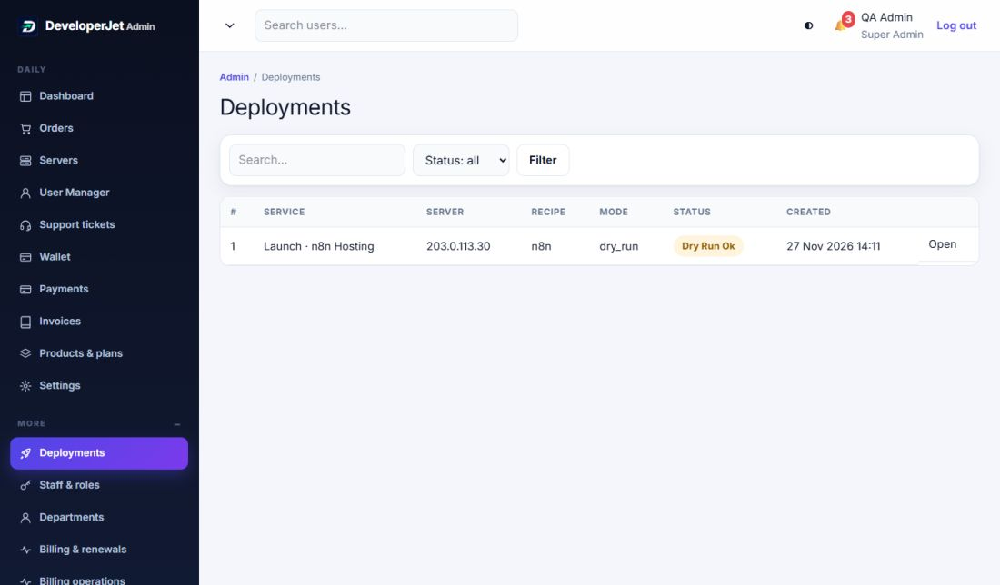

### Infrastructure

**Kis liye:** server kharidne aur supplier ka poora hisaab.

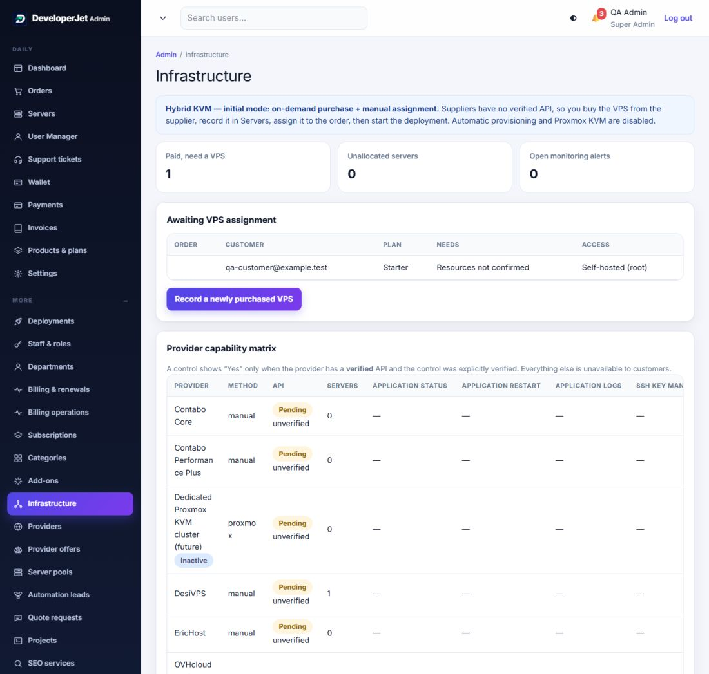

- **Awaiting VPS assignment:** kin orders ko server chahiye.
- **Record a newly purchased VPS:** naya VPS inventory mein daalo.
- **Provider capability matrix:** kis supplier ka API kya kar sakta hai. Abhi kisi ka API verify nahi hai, isliye sab manual hai.
- **Supplier renewals:** kis VPS ka supplier bill kab aana hai. Iske liye roz subah 8:30 par alert bhi aata hai.
- **Providers, Provider offers, Server pools** (More menu): suppliers ki list, unke plan aur aapki kharid ki keemat, aur server ke group.
- Proxmox (apna dedicated server) aur automatic VPS kharidna abhi **band** hai. Dedicated server aane par chalu hoga.

## 15. Sales: Leads, Quote requests, Projects, SEO (More menu)

**Automation leads:** Business Automation page se aaye sales lead.

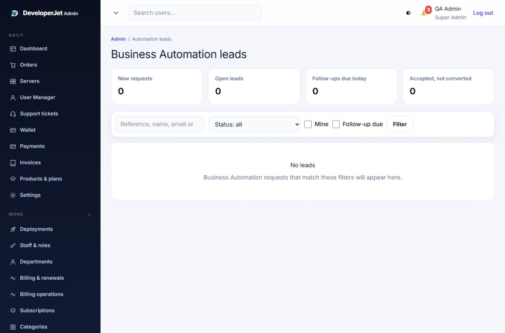

- Sales aur technical owner assign karo, follow-up date rakho, status badlo, quotation banao/badlo.
- Note likho, client se aur jaankari maango (email jaata hai).
- Lead ko client account se jodo, ya **project** banao. Isse order ya invoice nahi banta.

**Quote requests:** customer ki "requirement" request. **Send quote** se proposal bhejo. Paisa nahi kat-ta.

**Projects:** custom kaam ki tracking.
- Status, due date, tasks (todo/doing/done), milestones.
- "Upload & request client approval".
- Client ko message.

**SEO services:** manual SEO audit, tasks, PDF report upload karke client ko publish karna. Search Console abhi juda nahi hai.

## 16. Docs, Notifications, Security logs, Exports (More menu)

| Section | Kis liye |
|---|---|
| **Documentation / Doc categories** | Website ke `/docs` articles likhna aur badalna (Markdown). Publish ON/OFF |
| **Notifications** | Har email/Telegram jo gaya ya fail hua. Fail Telegram aur Automation email par **Retry** |
| **Security logs** | Audit log: kisne, kab, kya kiya, kis IP se. Sirf padhne ke liye |
| **Exports** | CSV download: customers, orders, invoices, subscriptions, wallet, tickets, staff activity, deployments, leads. Tareekh aur status se filter |

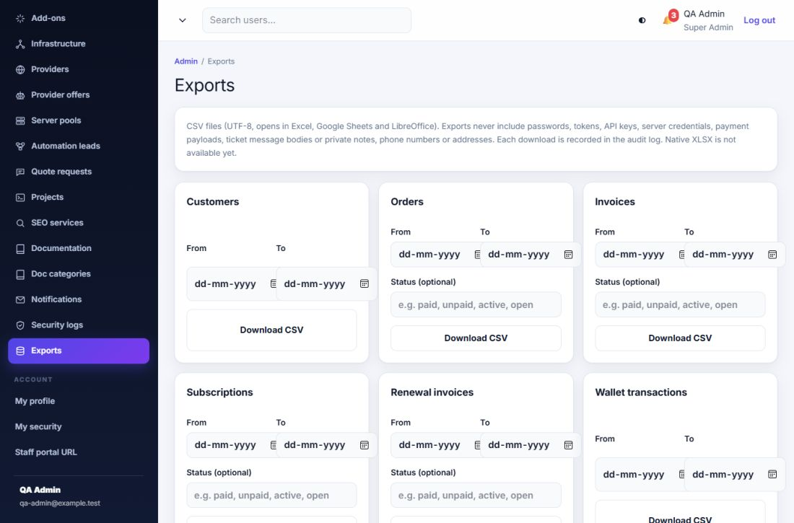

**Exports ki suraksha:** CSV mein **kabhi** passwords, API keys, server login, payment data, ticket ka text, private notes, phone ya address nahi aate. Har download audit log mein jaata hai.

## 17. Client ko kya dikhta hai (service panel)

Delivery ke baad client ke dashboard mein uska VPS panel hota hai. Ye admin panel ka hissa nahi hai, lekin aapko pata hona chahiye:

| Tab | Client kya dekhta/karta hai |
|---|---|
| **Overview** | Online/offline, live CPU, RAM, disk, network, uptime (har minute), server details, getting started |
| **Login & SSH** | IP, `root`, password (Show/Copy), SSH aur PuTTY ka tareeka. **Apna root password badalna** ya strong password banwana |
| **Manage** | Reboot, Restart app, Reset app login, Upgrade request, Domain, **Reinstall fresh** (`REINSTALL` type karke) |
| **Billing** | Plan, renewal date, invoices |

- Client root password **panel se** badle to panel chalta rehta hai.
- Agar client ne server par khud `passwd` se password badla, to panel ke buttons aur usage band ho jaate hain. Tab client se naya password lekar Servers page par update karo.

## 18. Server par chalne wali commands (cPanel terminal)

| Command | Kab chalaayein |
|---|---|
| `php artisan staff:create-super email@... "Naam"` | Naya Super Admin banana. Password chhupa ke poochha jaata hai |
| `php artisan staff:status email@...` | Staff login nahi ho raha? Kya galat hai, batata hai. Kuch badalta nahi |
| `php artisan staff:portal --show` / `--reset` | Staff login ka URL dekhna ya default par wapas lana |
| `php artisan orders:purge DJ2611000XX --dry-run` | **Test order** poori tarah delete karna. Pehle `--dry-run`, phir bina uske; order number type karna padta hai. Live payment wale order ko mana karta hai, VPS ko nahi chhoota |
| `php artisan billing:run` | Renewal ka kaam abhi chalana (roz 8 baje apne aap chalta hai) |
| `php artisan payments:reconcile` | Atke payments settle karna (har 15 minute apne aap) |
| `php artisan servers:check-renewals` | Supplier renewal alerts (roz 8:30) |

Apne aap chalne wale kaam (renewal, reminder, reconcile, SLA check) ke liye server par **cron** (`schedule:run`) aur email/Telegram ke liye **queue worker** chalna chahiye.

## 19. Kya abhi band hai ya baad mein aayega

| Cheez | Abhi ka haal |
|---|---|
| n8n, Hermes CLI, Claude Code, Docker VPS ka auto install | **Chalu** (test VPS par check kiya hua) |
| Node.js Hosting ka auto install | Chalu, lekin abhi sirf ek saaf Ubuntu container mein check hua hai. Pehla asli order dhyan se dekhna |
| Hermes Workspace, OpenClaw, AI Complete Bundle installer | Abhi nahi. Deploy uss step par ruk jaata hai |
| Apna dedicated server (Proxmox) se VPS apne aap banana | Baad mein, dedicated server aane par |
| VPS power off/on aur browser console | Proxmox ke saath aayega |
| Supplier API (DesiVPS, Contabo) se suspend/renew | Koi API verify nahi hai. Abhi staff manually karta hai |
| Razorpay | Code taiyaar hai, lekin live account par abhi check nahi hua |
| Server monitoring, Google Search Console | Juda nahi hai |
| Excel (XLSX) export | Abhi sirf CSV |
| Client se apne aap paisa katna | **Kabhi nahi.** Ye jaan-boojh kar band hai |
